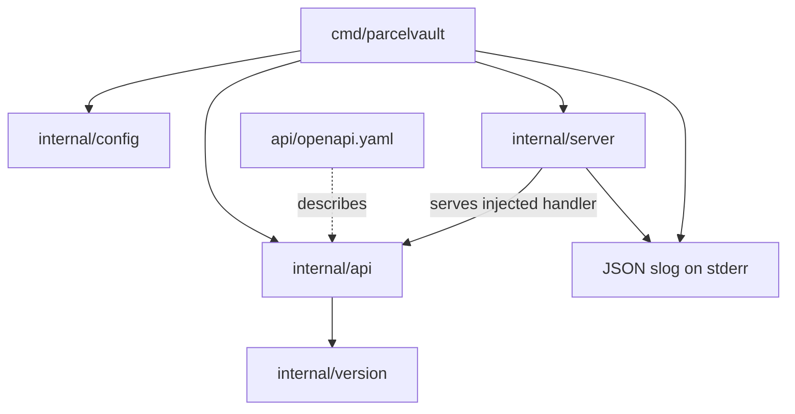
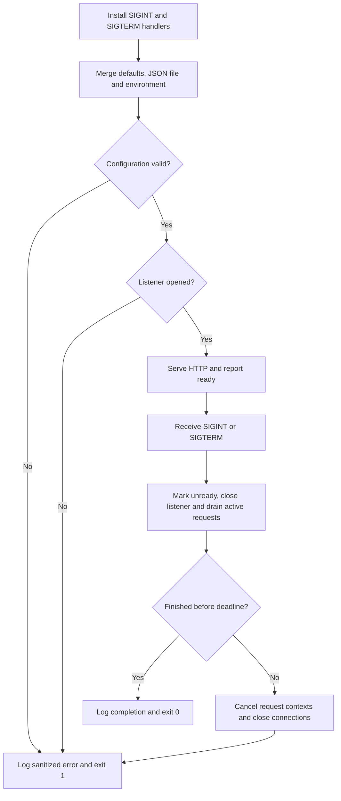
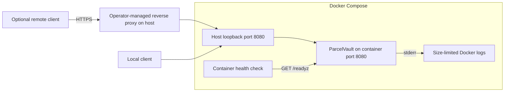

# ParcelVault v0.0.1

## Repository architecture

## Startup and shutdown

## High-level deployment

The proxy is optional infrastructure supplied by the operator. The application runs as UID and GID 65532 with a read-only root filesystem.
